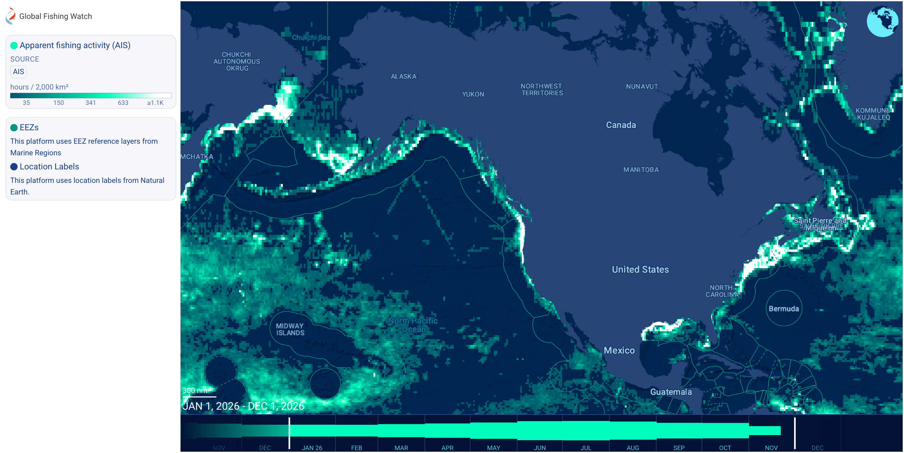

# Fishing Effort Analysis


<p align="center">
  <a href="[https://globalfishingwatch.org/our-map/]">Map of publicly-tracked fishing effort the United States Exclusive Economic Zone in 2026, via Global Fishing Watch</a>
</p>

## About
This repository contains data and code for an analysis of US fishing effort before, during, and after COVID.

## Repository Structure

[this is a placeholder, delete comments/update with correct file structure later]

```
fishing-effort-analysis
├── README.md
├── _quarto.yml # tells Quarto to render your blog post into docs/
├── data/       # raw input data and metadata (never edited by hand)
├── docs/       # rendered blog post, published with GitHub Pages
├── output/     # cleaned data and other intermediate files
├── R/          # R scripts with function definitions
└── reports/
    └── blog-post.qmd

```

## Data Access
The data for this analysis is not housed in this repository. Fishing effort data for [insert years or other specs] was downloaded from [Global Fishing Watch](https://globalfishingwatch.org/data-download/) and used locally. Data files:
* `insert_filename`
* `insert_filename`

## Authors
[Courtney Lorey](https://github.com/cllorey/cll214final), Bren School of Environmental Science & Management, University of California, Santa Barbara

## References

[EXAMPLE REFERENCE FORMAT BELOW - UPDATE/REPLACE]

County of Los Angeles. (2025). *Palisades and Eaton Dissolved Fire Perimeters* [Data set]. LA County Open Data. Retrieved November 2026, from [https://data.lacounty.gov/maps/ad51845ea5fb4eb483bc2a7c38b2370c/about](https://data.lacounty.gov/maps/ad51845ea5fb4eb483bc2a7c38b2370c/about)